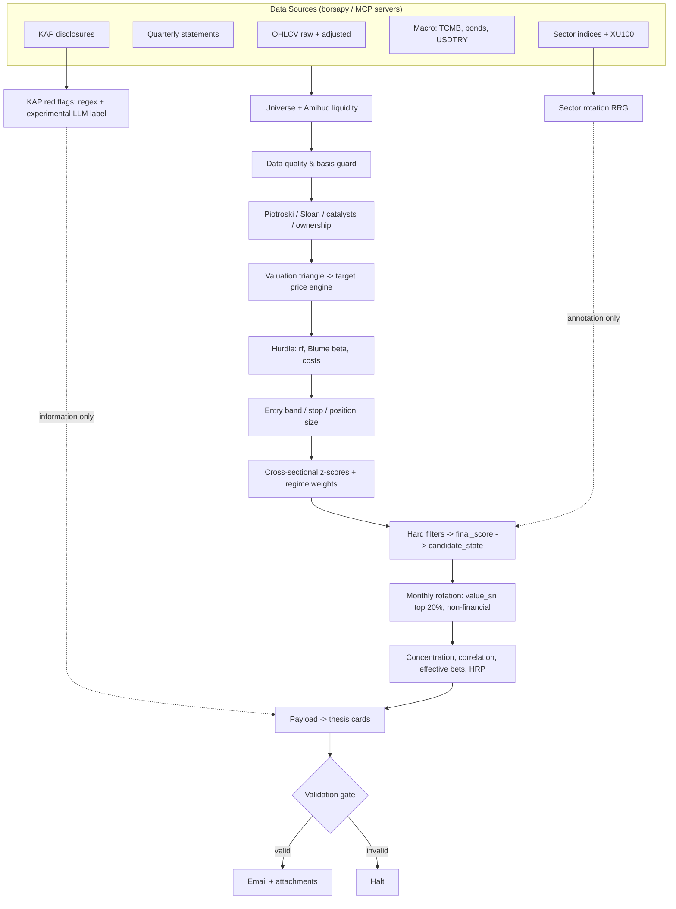
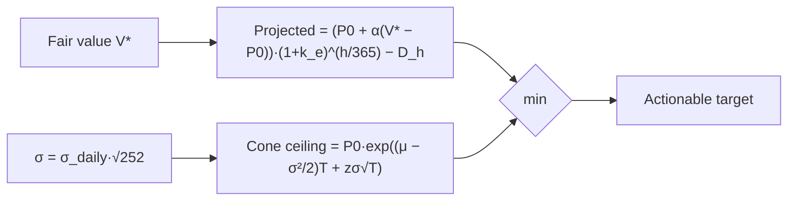
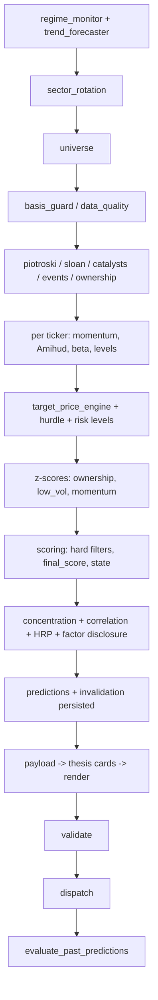

<div align="center">

# Autonomous BIST AI Screener

**A deterministic, multi-factor equity screening and research system for Borsa İstanbul.**


</div>

---

> **Disclaimer**
> This project is for research and decision support only. It does **not** constitute investment advice. Scores, rankings, target prices, and expected returns are model outputs, not guarantees of future performance.

> **Status (2026-10-17)**
> The live decision rule is a single, pre-registered and backtested rule: hold the **top 20% of non-financial stocks by sector-neutral value (`value_sn`)**, equal-weighted, rebalanced monthly (AL / TUT / SAT). Every other layer (targets, entry bands, stops, catalysts, KAP red flags, LLM labels, sector rotation) is **information only**, because its pre-registered test failed or it has no history to test. Of 25 pre-registered studies, the only new signal that passed is the sovereign spread, and only as a same-month explanation of BIST, not a forecast. It is shown as a risk gauge. After the same costs, the value rule beats its own equal-weighted universe in 2021+ (+6.9%/yr, t 2.6). It trails BIST 100 total return (−1.7%/yr, t −0.3): against that index it is a beta-1 portfolio with no alpha, and the gap is not explained by the missing bank weight. The edge over its own universe comes from picking within sectors; since 2021 most of it is a low-volatility tilt. After deflating for the 75 stock-selection trials run on this panel, the Sharpe ratio is not significant (DSR 0.12; 0.10 after the 6 SMC trials, N = 81), although value_sn is the most robust choice among 48 variants (PBO 0.06). At 3× costs, 10M TL and no trading at the daily limit, the edge stays positive but is no longer significant ([`quant_review_followups_preregistration.md`](docs/research/quant_review_followups_preregistration.md)). Adding 39 delisted stocks cuts its 2013–2020 edge by about 2.4%/yr; the ranking itself holds. The 2021+ edge sits close to the t = 2 threshold, so labels such as lag- or survivorship-sensitive flip with small definition changes (see [`c1_panel_rebuild.md`](docs/research/c1_panel_rebuild.md)). Figures are on the C1 panel (IAS 29 flows in one purchasing-power unit) unless a study row says otherwise. See [Live Decision Rule](#live-decision-rule-monthly-rotation) and the [research scorecard](#pre-registered-research).

---

## Table of Contents

- [Overview](#overview)
- [Architecture](#architecture)
- [Live Decision Rule: Monthly Rotation](#live-decision-rule-monthly-rotation)
  - [Realistic Return Reference](#realistic-return-reference)
- [Analysis Layers](#analysis-layers)
  - [Price Data: Raw vs. Adjusted](#price-data-raw-vs-adjusted)
  - [Universe Construction & Amihud Illiquidity](#universe-construction--amihud-illiquidity)
  - [Cross-Sectional Ranking & Sector Neutralization](#cross-sectional-ranking--sector-neutralization)
  - [Scoring Model](#scoring-model)
  - [12-1 Momentum & Trend Smoothness](#12-1-momentum--trend-smoothness)
  - [Financial Quality](#financial-quality)
  - [Valuation Triangle](#valuation-triangle)
  - [Target Price Engine](#target-price-engine)
  - [Hurdle Rate, Beta & Transaction Costs](#hurdle-rate-beta--transaction-costs)
  - [Entry Band, Stop-Loss & Position Sizing](#entry-band-stop-loss--position-sizing)
  - [Support / Resistance & Volume Profile (Information Only)](#support--resistance--volume-profile-information-only)
  - [Sector Rotation (RRG)](#sector-rotation-rrg)
  - [ML Trend Forecaster & Market Regime](#ml-trend-forecaster--market-regime)
  - [Portfolio Construction (HRP)](#portfolio-construction-hrp)
  - [Catalysts, KAP & FinBERT Sentiment](#catalysts-kap--finbert-sentiment)
  - [KAP Red Flags (Information Only)](#kap-red-flags-information-only)
  - [Corporate Actions, Dividends & Ownership](#corporate-actions-dividends--ownership)
- [Research Infrastructure](#research-infrastructure)
- [Pre-registered Research](#pre-registered-research)
- [Backtests & Evidence](#backtests--evidence)
- [Reports & Delivery](#reports--delivery)
- [Validation Gate](#validation-gate)
- [Execution Pipeline](#execution-pipeline)
- [GitHub Actions](#github-actions)
- [Project Structure](#project-structure)
- [Installation](#installation)
- [Operating Modes](#operating-modes)
- [Running](#running)
- [Testing](#testing)
- [Configuration](#configuration)
- [Known Limitations](#known-limitations)
- [Design Principles](#design-principles)
- [Roadmap](#roadmap)
- [License](#license)

---

## Overview

`bist-screener` evaluates BIST-listed companies on several dimensions at once: valuation, catalysts, ownership, volatility, momentum, financial quality, and expected return against a hurdle rate. It does not rely on any single metric.

The system runs as a daily pipeline and produces:

| Output | Description |
|---|---|
| Mobile email body | Single-column, inline-styled summary: monthly AL/TUT/SAT rotation, diversification (effective bets), KAP red-flag panel, country risk (Turkey sovereign spread, risk gauge), untested financials, realised-return reference (TL, USD, vs. deposit), long-term cards (price, "buy at next close"), experimental short-term watchlist |
| Detailed HTML report (attachment) | Full tables, thesis dossiers, methodology, WhatsApp-ready quick-copy block |
| Sector rotation Excel (attachment) | RRG summary, 5-week tail chart, data table, method sheet |
| JSON payload (attachment) | Every number shown in the reports, machine-readable and auditable |
| KAP sentiment JSON | FinBERT scores of recent disclosures for reported candidates |
| Streamlit dashboard | Read-only visualisation of the SQLite history |

**Core commitments:**

- Deterministic calculations: same input, same output.
- Missing data stays `None`; it is never estimated silently.
- Peer-relative ranking instead of universal fixed thresholds.
- Priors are disclosed as priors; evidence is reported with its t-statistic.
- No report is sent unless every number in it traces back to the payload.
- Every return test is pre-registered: the hypothesis and pass rule are committed before the run, and results are appended in a later commit.

---

## Architecture



---

## Live Decision Rule: Monthly Rotation

`core/rotation.py` implements rule R0 from [`docs/research/exit_rules_preregistration.md`](docs/research/exit_rules_preregistration.md):

- **Universe:** long-term candidates with a sector-relative valuation z (`valuation_z` = the tested `value_sn`: mean z of E/P, B/M, S/P and EBIT/EV, demeaned within sector). The four ratios are built exactly as in the research panel: the latest quarter **usable on the decision day** from İş Yatırım (usable from its first KAP publication, or the next day when published after 18:00; without a KAP match, the panel's 75/100-day lag; a quarter usable only after the run day is skipped) (`pit_panel.fetch_statement`), TTM net income, sales and operating profit, and that quarter's equity and financial debt minus cash (`pit_panel.value_ratios`, via `live_data.live_value_inputs`). A missing ratio stays missing; it is not filled from provider P/E, P/B or annual statements. Since 2026-10-17, IAS 29 flows (periods from 2023Q4) are put into one purchasing-power unit with the TÜİK CPI before quarters and TTM are formed (C1, [`ias29_constant_unit_ttm_preregistration.md`](docs/research/ias29_constant_unit_ttm_preregistration.md)). If CPI cannot be fetched, the whole run falls back to C0, and the record says so (`ttm_unit`). Stored research panel files built before this date are C0; `build_pit_panel.py` now builds C1. Quarantined names and names with too few peers are excluded.
- **Financials excluded:** banks, insurance, pension, factoring, leasing, savings finance, brokers, securities investment trusts and asset managers (`pit_panel.FINANCIAL_SECTORS`). The tested panel never contained them. Their own top 20% is shown separately as "test edilmedi" (untested, information only).
- **Liquidity cut:** the bottom 30% of non-financial long-term candidates by 60-day median daily TL volume (close × volume, at least 40 bars) are dropped before ranking, as in the tested panel (`factor_backtest.prepare`, `liq_drop_pct=0.3`). The live universe floor of 10M TL is looser; before this cut, about a third of the live top 20% came from the untested illiquid tier.
- **Rule:** hold the top 20% equal-weighted. The first run of each month stores the list in `rotation_holdings`; later runs in the same month reuse it. A name that leaves the top 20% is sold.
- **Output:** AL (new), TUT (kept), SAT (dropped).
- **Locked rule and forward record:** the parameters are fixed in `config/live_rule.json` (version `R0-2026-10-12`); a test fails if `core/rotation.py` drifts from it. From the 2026-11 rebalance, each live decision (list, ranked universe, rule version, UTC timestamp) is appended to `data/forward_record/decisions.jsonl` and committed by CI. Each record (schema 2) also stores the code commit SHA, the run health status, and for every ranked stock the four ratios and the items they are built from (TTM net income, sales and operating profit, equity, financial debt, cash, market cap), `valid_metric_count`, close and price date, 60-day TL volume, the statement quarter used, that quarter's first KAP publication time and first usable day (`None` when no KAP match; never invented), and the observation time. Runs that produce no decision (empty pool, run error, halted run) are recorded as `no_decision` until the month has a decision. `scripts/forward_record_report.py` prices the recorded decisions with the pre-registered portfolio simulator (next-close fills, 1M TL, base costs, cash earns the policy rate; a target with no fill-day price is not bought and its weight stays in cash until the next rebalance); it never re-selects. Evaluation is per calendar month. In a month without a decision, the book is carried without trades and that month is its own period, so annualised figures always rest on monthly observations. Prices are fetched fresh at report time, from the first decision on. Each live run also writes the daily bars of every recorded stock to `data/forward_record/prices/<TICKER>.csv` (`core/forward_prices`; older rows are rescaled when the adjusted series changes). When the provider no longer returns a stock (delisting, merger, code change), the report uses this store. A held stock with no prices anywhere counts as a −100% loss and is listed under `price_sources`; it is never silently dropped. It reports the pre-registered delisting assumption (no haircut) next to the 50% haircut sensitivity, compares with both the investable EW universe (`EW net`, primary: same simulator, capital, cost model, fill timing and cash rate) and the zero-cost EW universe (`EW gross`, complementary), as well as XU100 price and BIST 100 total return, and lists months without a decision. Indices are fetched from the first decision on. The report stops if XU100 does not cover it; BIST 100 TR is dropped and flagged in that case. An EW-universe period counts only if the start, fill-day (in decision months) and end prices are genuinely observed (not forward-filled across gaps; stale price age in trading days is measured and reported) for at least 95% of the recorded universe; invalid periods are counted, not filled, and Newey-West HAC t-statistics preserve calendar-month lags across any missing months while reporting the missing-month count and observation span. A rule change needs a new pre-registration and version and starts a new series.
- **Diversification:** average pairwise 60-day log-return correlation of the held basket and the effective number of bets $`N/(1+(N-1)\bar\rho)`$ (`core/correlation.py::effective_bets`).

Hurdle, Piotroski, target-price gates do **not** affect this list: the tested rule did not contain them.

### Realistic Return Reference

Long-term cards no longer show model targets, expected ROI, entry bands or stops. The target backtest predicted +25.1% 6-month excess for the cheapest quintile against +1.4% realised, and the entry and exit rules failed their tests. Instead, the bulletin shows what the live rule actually returned (`scripts/realized_return_reference.py` → `config/realized_returns.json`), holdout 2021-01 → 2026-03, 63 months, 6-month horizon:

| Series | Median | Mean | Share positive |
|---|---|---|---|
| Single stock, TL | +12.7% | — | 64.1% |
| Single stock vs. XU100 | −7.5% | — | 39.5% |
| Basket vs. XU100 | +1.4% | +3.3% | 52.4% |
| Basket, TL | +20.4% | +30.2% | 81.0% |
| Basket, USD | +3.5% | +9.9% | 52.4% |
| TL deposit proxy (TCMB policy rate, gross) | +19.5% | +16.1% | 100% |
| Basket minus deposit | +3.6 pp | +14.2 pp | 50.8% |

The edge is at basket level; a single stock beats XU100 less than half the time. Delisted stocks are missing, so these numbers are optimistic.

**Against total-return and costed benchmarks** ([`total_return_benchmarks_preregistration.md`](docs/research/total_return_benchmarks_preregistration.md)). Holdout 2021-01 → 2026-08, 1M TL, base costs, monthly net active return (C1 panel):

| Benchmark | Active %/yr (t) | Label |
|---|---|---|
| Equal-weighted universe, same cost model | +6.89 (2.55) | beats |
| BIST 100 total return (`XU100_CFNNTLTL`) | −1.71 (−0.28) | behind |
| BIST All Shares total return (`XUTUM_CFNNTLTL`) | −2.11 (−0.44) | behind |
| *XU100 price (no dividends; flatters the rule)* | *+1.04 (0.17)* | — |

The tables above use XU100 price. Read them with this bias in mind: a BIST 100 total-return fund did about 1.7%/yr better than the rule in the holdout.

**Publication-date sensitivity** ([`kap_report_dates_preregistration.md`](docs/research/kap_report_dates_preregistration.md)): with actual KAP publication dates instead of the assumed 75/100-day lag, value_sn still ranks stocks (holdout rank IC t 4.74). The holdout top-quintile net active fell from +6.87%/yr (t 2.09) to +5.26%/yr (t 1.59). By the pre-registered rule the result is **lag-sensitive**. The research panel now uses actual dates by default.

---

## Analysis Layers

The layers below feed the scoring pipeline and the reports. Except for `valuation_z`, they are **information only** in the live decision.

### Price Data: Raw vs. Adjusted

BIST companies issue bonus shares often (ASELS 2012/2016/2020/2023, AKFIS 500% in 2026). In the raw price series such an event looks like a −50% to −83% crash. `core/live_data.py::live_prices()` therefore returns two series:

| Field | Source | Used for |
|---|---|---|
| `close` | `borsapy` history, `adjust=False` | Price levels: market cap, P/E, entry, stop, target |
| `adj_close` | `borsapy` history, `adjust=True` | Every return: momentum, beta, correlation, covariance, volatility, Amihud |

SMA20/50 and ATR20 are computed on the adjusted scale and converted back to the raw scale of the same day:

```math
\text{SMA}_{20,t} = \frac{1}{20}\sum_{k=0}^{19} \text{adj}_{t-k} \cdot \frac{\text{close}_t}{\text{adj}_t}
```

Example (bonus day): BIMAS 100% bonus, raw return −49.1%, adjusted +1.8%. AKFIS 500% bonus, raw −82.2%, adjusted +6.6%.

### Universe Construction & Amihud Illiquidity

In live mode the universe is built dynamically (no hardcoded list). Filters: minimum 20-day average TL volume (default 10M TL), listing history, trading restrictions (tedbir/VBTS), data completeness, and reporting basis.

Amihud (2002) illiquidity, on adjusted returns:

```math
\text{ILLIQ} = \frac{1}{D}\sum_{d=1}^{D}\frac{|R_d|}{\text{VolumeTL}_d}\times 10^6
```

### Cross-Sectional Ranking & Sector Neutralization

Metrics are ranked within the peer group, not against fixed cutoffs. `valuation_z` is standardised inside the sector. If a sector has fewer than 5 peers, it falls back to the supersector (`XUMAL`, `XUSIN`, `XUHIZ`, `XUTEK`). Too few peers gives `confidence = insufficient_peers`, which is a hard filter.

### Scoring Model

`core/scoring.py`:

```math
\mathrm{final\_score} = w_v\,z_{\text{val}} + w_c\,s_{\text{cat}} + w_o\,z_{\text{own}} + w_l\,z_{\text{lowvol}} + w_m\,z_{\text{mom}}
```

Weights (`config/weights.yaml`), set by the Phase 2 pre-registration (`docs/research/long_term_preregistration.md`, 2026-10-10):

| Factor | Weight | Definition |
|---|---|---|
| `valuation_z` | 1.00 | Peer-relative mean z of E/P, B/M, S/P and EBIT/EV (the tested `value_sn` definition) for industrial, holding and REIT profiles. Bank and insurance profiles are untested and excluded from the rotation. |
| `catalyst_score` | 0.00 | Shown as information only; no history, cannot be tested |
| `ownership_quality_z` | 0.00 | Shown as information only; no history, cannot be tested |
| `low_vol_z` | 0.00 | Value + low-vol was weaker than plain value in the factor backtest |
| `momentum_z` | 0.00 | 12-1 momentum has no cross-sectional effect in BIST |

Plain value top quintile: net active +10.65%/yr in discovery (2013–2020, t 2.71) and +7.36%/yr in holdout (2021–2026, t 2.80; +6.96%, t 2.60 on the earlier C0 panel). Distress, crash, momentum, 52-week-high, GP/A and SUE additions did not pass. Regime weights were removed: the regime engine cannot be rebuilt point-in-time, and the macro study found no predictor of market direction. `config/weights_optimized.json` is still not used (`use_optimized=False`).

**Hard filters** (any failure → `NO_ACTION`): tedbir level ≤ 1, known reporting basis, sufficient peers, listing ≥ 90 days, free float ≥ 15%, `excess_over_hurdle_pct > 0`, expected ROI ≤ 200%, point-in-time data. The former Piotroski hard filter (≥ 0.34) was removed on 2026-10-21: the pre-registered low-F-score exclusions (H4b, H2b) did not help. Long-term bucket: additionally `valuation_excess_pct > 0` (base fair value above price) and `excess_over_beta_hurdle_pct > 0`. The hurdle gate alone passes almost every stock, because the CAPM drift $`k_e > r_f`$. Short-term bucket: additionally `volume_ratio_20d ≥ 1.5`.

**Candidate state:** `STRONG_OPPORTUNITY` needs high confidence, top quartile of `final_score` in the bucket, a positive hurdle margin, Piotroski ≥ 0.55, and no value-trap flag. A gate whose input is missing (`expected_roi_pct`, `valuation_excess_pct`, `excess_over_beta_hurdle_pct` = `None`) is UNKNOWN, not passed: the candidate stays at most `WATCHLIST` and the gate is listed in `unknown_checks` (Excel column "Eksik veri"). Top 4 per bucket are reported. These labels are not tested and do not affect the rotation; reports show them as information only.

### 12-1 Momentum & Trend Smoothness

`core/momentum.py` (Jegadeesh & Titman 1993), on adjusted closes:

- $`\text{mom}_{12-1} = P_{t-21}/P_{t-252} - 1`$ (skips the last month to avoid short-term reversal).
- Trend smoothness: signed $`R^2`$ of $`\ln P_\tau = \alpha + \beta\tau + \epsilon`$ over 120 days.
- `rs_xu100_60d_pct`: 60-day return relative to XU100.

```math
\mathrm{momentum\_score} = \text{clip}_{[0,100]}\Big(50 + \text{clip}(0.3\,\text{mom}_{12-1}, \pm25) + 15\,R^2_{\pm} + \text{clip}(0.5\,\text{rs}_{60}, \pm15)\Big)
```

**Value-trap flag:** $`\text{mom}_{12-1} < 0`$ and signed $`R^2 < 0`$. It blocks `STRONG_OPPORTUNITY`. Information only: comparable exclusions (momentum, crash, distress, low F-score) failed their pre-registered tests.

### Smart Money Concepts (information only)

`core/smc.py` is a point-in-time Python implementation of the common Smart Money Concepts ideas, with LuxAlgo's "Smart Money Concepts" TradingView script as the concept reference: swing (50-bar) and internal (5-bar) pivots, break of structure (BOS) and change of character (CHoCH) on closes, order blocks (the extreme bar of the leg, high-volatility bars inverted, removed when price trades through them), fair value gaps with an automatic threshold, equal highs/lows, and premium/discount zones of the trailing swing range. Events are dated on the bar where they become known, so there is no repainting. Each long-term candidate gets a summary (swing and internal trend, last break, zone, nearest bullish order block below and bearish order block above), shown in the Excel sheet "Tek Hisse Kontrol". It does not change the rotation: in the pre-registered timing test ([`smc_timing_preregistration.md`](docs/research/smc_timing_preregistration.md)) none of 4 SMC entry rules (order-block pullback, discount zone, internal CHoCH confirmation, FVG fill) beat buying at the next close, and neither CHoCH exit beat the buffer rotation.

### Financial Quality

- **Piotroski F-Score** (9 criteria, normalised to [0, 1]). Information and the untested `STRONG_OPPORTUNITY` label only; no hard filter. With a nominal (non-IAS 29) feed, criteria 3/5/6/8 are distorted by inflation, so the middle band carries weak signal.
- **Sloan accrual**: gap between accounting earnings and cash flow.

### Valuation Triangle

`core/valuation_triangle.py`, weights from `config/weights.yaml` (single source):

| Leg | Weight | Method |
|---|---|---|
| DCF | 0.00 | FCF, WACC (CAPM + cost of debt), low/base/high growth 0/5/10%; reference only (`dcf_reference`) |
| Peer multiples | 0.50 | Harmonic mean of peer P/E, EV/EBITDA, P/B (Liu, Nissim & Thomas 2002); banks/insurance/REITs exclude EV/EBITDA |
| Quality premium | 0.00 (untested; since 2026-10-21) | Justified P/B = ROE / $`k_e`$, with Piotroski, balance sheet, and high-ROE modifiers |

Why DCF has weight 0 (since 2026-10-21): the DCF here runs on nominal TL FCF with a WACC of about 45%, so terminal assumptions dominate it, and no test covers the DCF leg. Studies of target-price accuracy also favour multiple-based methods. The convergence $`\alpha`$ was measured on the peer leg only. A leg with weight 0 is not in the target or the method name. If a leg is not available, the remaining weights are re-normalised. GYO and holding companies use NAV.

The target is the base fair value. The former scenario weights ($`P(\text{bull}) = p^2`$, $`P(\text{base}) = 2p(1-p)`$, $`P(\text{bear}) = (1-p)^2`$ from the trend model's `prob_up`) were removed on 2026-10-21: they treat the scenarios as two independent coin flips, `prob_up` never reached the live target, and the trend model has no passing test.

### Target Price Engine

`core/targets.py::compute_long_term_target` separates the **180-day actionable target** from the **terminal fair value** $`V^*`$ (triangle output, information only).



- **Cost of equity:** $`k_e = r_f + \beta_{\text{Blume}}\cdot\text{ERP}`$, with $`r_f`$ = 2-year bond yield and ERP = 5% (`config/equity_risk_premium.yaml`).
- **Drift:** under CAPM, a fairly priced stock earns $`k_e`$. The price target is net of the expected dividend $`D_h = \text{DPS}_{\text{TTM}}\cdot h/365`$, because the price drops by the dividend. The dividend is added back at the hurdle gate.
- **Partial convergence:** $`\alpha = 0.05`$ (`target_convergence_alpha` in `config/weights.yaml`). The cross-sectional target backtest measured 0.031 (t = 2.5); the old value 0.32 came from a single XU100 series. See [Backtests & Evidence](#backtests--evidence).
- **Volatility cone:** $`\mu = \ln(1+k_e)`$, $`T = 180/365`$, $`z = 1.75`$ (`DEFAULT_CONE_Z`, an uncalibrated prior). $`\sigma_{60d}`$ is the stdev of *daily* returns and is annualised with $`\sqrt{252}`$. Before 2026-09-27 a unit bug treated it as annual, which pinned every ceiling near $`1.2\,P_0`$.
- **Target-hit probability (model):** lognormal with $`E[S_T]`$ equal to the projected price:

```math
P(S_T \ge K) = \Phi\!\left(\frac{\ln(E/K) - s^2/2}{s}\right),\quad s = \sigma\sqrt{T}
```

  This is a model probability, not a realised hit rate. Empirical hit rates of analyst targets are about 40–55% (Bradshaw, Brown & Huang 2013).

> $`z`$ is a fixed assumption. `calibrated_z_score` in `config/weights_optimized.json` is not read: it is fitted on a single XU100 series with $`T`$ in trading days, while the cone uses calendar days on single stocks. $`\alpha`$ is not read from that file either.

**Short-term target** (20 days): $`P_0 + 2.5\cdot\text{ATR}_{20}\cdot b`$, where $`b \in [1.0, 1.3]`$ is a liquidity buffer that widens distances for thin books (20-day TL volume between 50M and 10M).

### Hurdle Rate, Beta & Transaction Costs

- **Hurdle** (compounded, not linear): $`h = \big((1 + r_f)^{T/365} - 1\big)\times 100`$. The linear form over-states the hurdle by about 1.5 points at 40% rates over 180 days.
- **Beta:** OLS on date-aligned daily adjusted returns vs. live XU100 (up to 120 observations), then Blume (1971) adjustment: $`\beta_{\text{Blume}} = 0.67\,\beta + 0.33`$. The beta-adjusted hurdle is an information field, not a hard filter.
- **Net return (information):**

```math
\text{cost}_{\%} = \big(\text{spread}_{bps} + 15 + \tfrac{20}{\max(\mathrm{vol\_ratio}_{20},\,0.1)} + \min(25\cdot\text{ILLIQ},\,50)\big)/100
```

  If spread or volume ratio is missing, the `net_*` fields stay `None`. An optimistic cost is never assumed.

### Entry Band, Stop-Loss & Position Sizing

`core/targets.py::compute_dynamic_risk_levels`. All levels are rounded to the BIST tick table (0.01 / 0.02 / 0.05 / 0.10 TL).

```math
\mathrm{entry\_low} = P_0 - 0.5\,\text{ATR}_{20},\qquad \mathrm{entry\_high} = P_0 + 0.2\,\text{ATR}_{20}
```

```math
\mathrm{effective\_entry} = \tfrac12(\mathrm{entry\_low} + \mathrm{entry\_high}) \quad\text{(50/50 scaled limit orders)}
```

```math
\text{stop} = \min\big(\mathrm{entry\_low} - 1.5\,b\,\text{ATR}_{20},\ \mathrm{swing\_low}_{20}\big)
```

```math
\mathrm{position\_size\_pct} = \min\!\left(25,\ \frac{1.5}{(\mathrm{effective\_entry} - \text{stop})/\mathrm{effective\_entry}}\right)
```

The short-term reward/risk ratio is measured from `effective_entry`, not from the spot price.

### Support / Resistance & Volume Profile (Information Only)

`core/levels.py` computes structure-based levels on the adjusted scale, so pre-bonus pivots do not create fake resistance:

1. **Confirmed fractal pivots** (5 bars on each side; the last 5 bars are never used, so there is no look-ahead). Weight = $`0.5^{\text{age}/60}\cdot(1 + \min(3, V_i/\bar V))`$.
2. **Volume profile:** each bar's volume is spread evenly over [low, high] in 60 bins. High-volume nodes (bins above mean + 1 sd and a local maximum) and the POC become extra level candidates. Rationale: S/R levels coincide with order-book depth (Kavajecz & Odders-White 2004).
3. **Zones:** candidates within 0.5 ATR are merged, and a zone is at most 1 ATR wide.
4. **Breakout:** a broken resistance counts only with `volume_ratio_20d ≥ 1.5` (Lo, Mamaysky & Wang 2000). After that it acts as support.
5. **VWAP20** is shown as an execution reference (Berkowitz, Logue & Noser 1988).

Levels are **not** used for entry, stop, or target, because the backtest did not support it (see [Backtests & Evidence](#backtests--evidence)). The reports show the nearest support/resistance, a *"resistance before target"* warning, and VWAP20. `compute_dynamic_risk_levels(level_plan=...)` and `compute_short_term_target(level_plan=...)` implement the level-based rules for future research.

### Sector Rotation (RRG)

`core/sector_rotation.py`, an open approximation of JdK RS-Ratio/RS-Momentum. It uses weekly (Friday) closes of 25 BIST sector indices vs. XU100:

```math
\text{RS} = 100\cdot\frac{\text{sector}}{\text{XU100}},\qquad \text{RS-Ratio} = 100 + \frac{\text{RS} - \mu_{26}(\text{RS})}{\sigma_{26}(\text{RS})}
```

```math
d_t = \text{RS-Ratio}_t - \text{RS-Ratio}_{t-4},\qquad \text{RS-Momentum} = 100 + \frac{d_t - \mu_{26}(d)}{\sigma_{26}(d)}
```

Quadrants: Leading (R ≥ 100, M ≥ 100), Weakening, Lagging, Improving. A *future star* is a sector that moved Lagging → Improving within the last 3 weeks. RRG is **annotation only** and does not enter `final_score`. The email card shows each candidate's sector quadrant, and the Excel attachment shows where money is moving.

### ML Trend Forecaster & Market Regime

`core/trend_forecaster.py`: 25+ technical features on XU100 (SMA distances, 5–60d returns, RSI, MACD, volatility ratios, Bollinger width, 52-week drawdown). It uses a Random Forest + Logistic Regression ensemble whose weights come from 3-fold `TimeSeriesSplit` Brier loss (current: LR 0.95, RF 0.05). Output `prob_up` → regime:

| Regime | Rule |
|---|---|
| `OVERSOLD_REVERSAL` | RSI < 36 and −6% < distance to SMA200 < 2% |
| `STRONG_BULL` | `prob_up` ≥ 0.62 and distance to SMA50 > −1% |
| `MILD_BULL` | `prob_up` ≥ 0.52 |
| `STRONG_BEAR` | `prob_up` < 0.40 and distance to SMA50 < −3% |
| `CORRECTION_CHOPPY` | otherwise |

Regime weights were removed from scoring (Phase 2); the regime is shown as information only. The macro study found no predictor of market direction. The separate `regime_taxonomy` (macro labels in the report) is isolated from scoring by a static test.

### Portfolio Construction (HRP)

`core/correlation.py`: pairwise Pearson correlation on 60-day **log returns** of the held AL/TUT basket (until PR #29 it used price levels, which flagged about 6,900 spurious pairs a day). Flags above 0.85 are information only.

`core/portfolio.py`: Hierarchical Risk Parity (López de Prado 2016). Distance $`d_{ij} = \sqrt{\tfrac12(1-\rho_{ij})}`$, Ward linkage, quasi-diagonalisation, recursive bisection, no matrix inversion. Covariance comes from adjusted returns, and the sector cap is 30%. Risk parity, minimum variance, and max Sharpe are also available.

### Catalysts, KAP & FinBERT Sentiment

- **Catalyst score:** rule/regex classification of KAP titles, with time decay (`config/catalyst_decay.yaml`). It is deterministic and reproducible. Weight 0.
- **FinBERT layer** (`core/kap_sentiment.py`, `scripts/kap_sentiment_today.py`): disclosure bodies from the last 3 days → `opus-mt-tr-en` translation → `ProsusAI/finbert`. Runs daily in CI after the screener and writes `data/reports/kap_sentiment_<date>.json`. **Information only**, not in `final_score`.

### KAP Red Flags (Information Only)

- **Classifier** (`core/kap_red_flags.py`): regex only, on the KAP subject and short summary. Seven categories: insolvency (konkordato, iflas, restructuring, TTK 376), going concern, auditor adverse/qualified opinion, regulatory sanction (SPK, Competition Authority, tax, trustee, detention), market sanction (watch-list market, gross settlement), lawsuit or seizure against the company, board / CEO resignation. Rules were tuned on the subject/summary frequency table of the archive and hand-read samples, never on returns.
- **Panel** (`core/kap_red_flag_panel.py`): for AL/TUT holdings, red flags of the last 180 days grouped by category with count, latest date and KAP link. Source: the KAP `byCriteria` endpoint (`core/kap_api.py`). Only days missing from `kap_fetch_log` are fetched (one request on a normal day); on a KAP error it stops and fills the gap next run. With missing days the panel says "partial" or "KAP verisi alınamadı", never "no flags".
- **Experimental LLM label** (`core/kap_llm.py`): subject + summary are sent in batches of 20 to an OpenAI-compatible endpoint (default Groq `openai/gpt-oss-120b`, key `GROQ_API_KEY`). The model may only return one of the seven categories or `none`; unknown output is dropped. Labels are stored with model and prompt hash in `kap_llm_labels` for a future forward-only test, and the bulletin shows them on a separate "Deneysel LLM etiketi" line only where the regex found nothing. They never enter score or decision. GitHub Models was retired on 2026-07-30 and is no longer used.
- **Test:** excluding flagged names from the value top quintile did **not** pass ([`kap_red_flags_preregistration.md`](docs/research/kap_red_flags_preregistration.md)).

### Corporate Actions, Dividends & Ownership

- `event_calendar`: dividends, bonus/rights issues, general assemblies. A warning is raised when the trade horizon crosses an event.
- Dividend sustainability (streak, payout) and a Gordon reference value.
- Ownership quality where data exists. Missing data is never treated as a signal.

---

## Research Infrastructure

**Point-in-time fundamentals panel** (`core/pit_panel.py`, `scripts/build_pit_panel.py`), added 2026-09-27:

- Up to 60 quarterly statements per non-financial ticker via `borsapy`.
- **Publication lag:** a statement is available only from $`\text{period end} + 75`$ days (Q1–Q3) or $`+100`$ days (Q4). The panel never uses data before `available_at`.
- Quarterly flows from YTD tables: $`Q_1 = \text{YTD}_1`$, $`Q_n = \text{YTD}_n - \text{YTD}_{n-1}`$. TTM needs 4 consecutive quarters (80–100 day gaps).
- Share count: paid-in capital, forward-adjusted through later bonus/rights events.
- Monthly factors: `bm`, `ep`, `sp`, `ey` (EV/EBIT), `gpa`, `roe`, `mom_12_1`, `str_1m`, `vol60`, `tlvol60`, `nsi_rights_12m`, `sue` (Foster, Olsen & Shevlin 1984), with forward returns `fwd_ret_1m`, `fwd_ret_6m`.
- Excludes banks, insurance, pension, factoring, leasing, brokers, and real-estate funds (different templates).
- Output: `data/research/*.parquet` (gitignored, rebuilt by the script).

Full build: 583 non-financial tickers, 0 failures, 24,089 quarter rows, 58,223 monthly factor rows (2012-09 → 2026-09).

**KAP disclosure archive** (`scripts/build_kap_archive.py`): all IGS disclosures since 2010 from the kap.org.tr `byCriteria` endpoint, delisted companies included. Weekly windows, day-by-day re-query when a window hits the 2,000-row cap, monthly cache with resume. Full build: 637,454 disclosures, 987 tickers, 2010-01-04 → 2026-10-11 (`data/research/kap_archive.parquet`, gitignored).

borsapy 0.11 joins its 4-quarter batches on row labels. Duplicated labels (for example short- and long-term `Finansal Borçlar`) therefore multiply per batch (2^15 copies over 15 batches). `build_pit_panel.py` fetches the batches itself and aligns rows by (label, occurrence) (`pit_panel.merge_statement_batches`).

---

## Pre-registered Research

Since 2026-09-28 every return test follows the same discipline:
- hypotheses, data, metrics and the pass rule are committed **before** the run;
- results are appended afterwards, without changing the earlier sections;
- a changed definition counts as a new test.

The usual pass rule is:
- discovery (to 2020) with the expected sign and $`t > 3`$ (Harvey-Liu-Zhu);
- holdout (2021+) with the same sign and $`t > 2`$.

Predictive macro tests also need a positive out-of-sample R² and a significant Clark-West test. Each study document gives its exact rule, its data and its known limits.

**Scorecard: 26 studies (25 pre-registered plus the Phase 1 diagnostics), dozens of confirmatory tests, one confirmatory PASS** (the sovereign spread *explains* BIST in the same month). Some rules were confirmed, though not as passes against a stricter alternative:
- value_sn ranks stocks (`long_term`), also under IAS 29 at a lower IC (`ias29_regime`);
- the live rule survives realistic costs against the EW universe (`portfolio_backtest`), also when the universe pays the same costs (`total_return_benchmarks`). It does **not** beat BIST 100 total return.

**Two layers of evidence.** Everything in this table is *historical research*. Its limits stay in force:
- Statement values are the provider's current version, not the originally published figures; only publication dates are point-in-time.
- Delisted stocks are only partly covered (39 with statements).
- The 2021+ holdout has been seen many times.

The *forward record* (`data/forward_record/decisions.jsonl`, from the 2026-11 rebalance) is the second layer. For each decision it stores the data, scores, statement quarter and KAP date, code SHA and run health at decision time, and it is never re-simulated. Over time it will be the stronger evidence. Historical results should not be read as more precise than these limits allow.

No test found a way to time the market or to beat the value rule.

### What the evidence says

1. **Stock selection.** Sector-neutral value (`value_sn`) is the only signal that reliably ranks BIST stocks (rank IC t ≈ 4.7 in both periods).
   - Its top-quintile edge in 2021+ weakens with actual KAP publication dates: t 2.09 → 1.59, labelled "lag-sensitive".
   - It lives in small, less liquid names. Excluding them costs return, and the bulletin shows them as information.
   - Against XU100, the rule's 2021+ edge is about zero.
2. **Market level.** BIST in USD is flat since 2005; the TL rise is the currency. Two things explain monthly moves in the same month:
   - EM equities (EEM);
   - Turkey's sovereign spread (R² 0.22 → 0.49 together).

   Nothing tested predicts the next month or year out of sample:
   - rates, inflation, VIX, oil, gold, the dollar;
   - industrial production;
   - the spread level.
3. **Behaviour, calendar and news.** None of the following showed a usable effect on BIST:
   - elections, shocks and wars;
   - Ramadan and pre-holiday days;
   - national-team football;
   - disclosure timing, buybacks and dividends;
   - sector spillovers.

   Two descriptive patterns are recorded as hypotheses for new data:
   - domestic shocks persist while regional conflicts fade within weeks;
   - pre-holiday sessions have been weak since 2016.

#### Stock selection and the live rule

| Study | Question | Result |
|---|---|---|
| [`short_term_preregistration.md`](docs/research/short_term_preregistration.md) | Any 20-day signal? | None of 6 passed. The short-term bucket is an experimental watchlist |
| [`phase1_diagnostics.md`](docs/research/phase1_diagnostics.md) | Why did live picks include crashed stocks? Currency? Survivorship? | Live score ≠ tested proxy; factor IC identical in TL, USD and XU100-excess; value premium fragile to survivorship |
| [`long_term_preregistration.md`](docs/research/long_term_preregistration.md) | Do distress, crash, momentum, quality or SUE improve value? | None of 9 passed. Live score = plain `value_sn` (+10.65%/yr discovery, +6.96%/yr holdout). C1 panel: holdout +7.36%/yr (t 2.80); verdicts unchanged |
| [`survivorship_delisted_preregistration.md`](docs/research/survivorship_delisted_preregistration.md) | Does value survive adding delisted stocks (İş Yatırım prices + statements for 39 exits, 2013–2022)? | By the rule: **survivorship-fragile** (KAP-date panel). The KAP-date baseline already fails holdout (t 1.99); with delistings: discovery +9.26% → +6.95%/yr (t 2.13), holdout +5.14% → +5.06% (t 1.94). On the 75/100-day panel it holds in every spec, including a −100% exit for all. The exit-return assumption does not matter: failing stocks drop below the liquidity cut before they exit. The loss comes from value traps while they are still listed (−1.39%/month active). Same result under the current net-debt rule (baseline rebuilt from cache: identical; 0 delisted rows changed). Live rule unchanged. C1 panel: S1 holdout +5.56%/yr (t 2.26) → SURVIVES_ROBUST_TO_WORST_CASE; the pre-registered C0 verdict stays on record (see `c1_panel_rebuild.md`) |
| [`ias29_regime_preregistration.md`](docs/research/ias29_regime_preregistration.md) | Does value_sn still rank stocks once statements are inflation-adjusted (IAS 29, periods from 2023-12)? | CONSISTENT by the rule. IAS 29 months (2024-05 →, 28): IC +0.034 (t 2.18) vs +0.077 in nominal 2021–2024; net active +2.98%/yr (t 0.70); difference −2.51%/yr (t −0.49). Exploratory: S/P IC turns negative after the switch (both panels); not acted on. Live rule unchanged. C1 panel: ADJ +4.14%/yr (t 1.06), ADJ − NOM −1.35 (t −0.28); still CONSISTENT |
| [`ias29_constant_unit_ttm_preregistration.md`](docs/research/ias29_constant_unit_ttm_preregistration.md) | Under IAS 29, should YTD flows be put into one purchasing-power unit before forming quarters and TTM (non-inferiority)? | ADOPT_C1. Pre-IAS 29 rows unchanged (0 mismatches). In IAS 29 months: IC unchanged (paired t −0.21), net active +1.16%/yr (t 1.43). The S/P sign flip remains, so it is not a unit artefact |
| [`value_ablation_preregistration.md`](docs/research/value_ablation_preregistration.md) | Does removing `S/P` (`V1: bm+ep+ey`) or restricting `value_sn` to `bm+ep` (`V2`) improve ranking and costed portfolio returns? | Both `KEEP_V0`. `ey` (`EBIT/EV`) is the strongest single leg (IC +0.042 discovery, +0.053 holdout); dropping it (`V2`) hurts IC in both periods (t −2.42, −2.00). Dropping `S/P` (`V1`) improves IAS 29 Rank-IC (+0.0088, t 4.01) and raises holdout costed active vs `EW net` from +6.89% (t 2.55) to +8.84%/yr (t 3.31; paired D +1.95%/yr, t 1.44), but lost −2.55%/yr (t −1.21) in 2013–2020 discovery. Live rule stays `V0`; `V1` tracked as IAS 29 shadow composite |
| [`ev_definition_preregistration.md`](docs/research/ev_definition_preregistration.md) | Should `ey`'s enterprise value net short-term financial investments and add minority interest? | KEEP_E0. The fix swaps 2–3 of ~60 holdings a month (93–97% overlap) and the removed stocks did better: paired D −1.03%/yr (t −0.69) discovery, −0.63%/yr (t −1.00) holdout, outside the non-inferiority bounds. Minority alone was neutral to slightly positive in holdout (post-hoc, not adopted). Live `ey` unchanged; N_sel 85 |
| [`bist_factor_reconciliation_preregistration.md`](docs/research/bist_factor_reconciliation_preregistration.md) | Why do academic BIST factor findings (Gökçen 2026: size, profitability, momentum, low risk) differ from our liquid screener tests? | Reconciled across 4 dimensions: (1) **Size** (+33.7%/yr, t 3.12 unfiltered) lives in the bottom 30% illiquid microcaps; on `liq_drop = 0.30` holdout IC is −0.057 (t −2.45). (2) **Profitability:** `OP/A` (IC +0.030, t 4.23) and `ROE` (holdout IC +0.037, t 3.78) beat `GP/A`, but add negative Fama-MacBeth slope alongside `value_sn` in discovery because `ep` and `ey` already capture earnings. (3) **Momentum:** `6-1` long-short `Q5−Q1` is +10.6%/yr (t 2.30), but long-only `Q5 − Univ` is +2.6%/yr (t 0.91). (4) **Low vol:** 100% high-vol loser avoidance (`Q1 − Univ` −8.6%/yr, t −2.51; `Q5 − Univ` −1.0%/yr, t −0.27); pre-filtering `Q1` from `value_sn` costs −1.84%/yr (t −1.33) |
| [`financials_holdings_reits_preregistration.md`](docs/research/financials_holdings_reits_preregistration.md) | Do dedicated valuation models for Banks/Financials (49 stocks, `UFRS`/`XI_29K`/`UFRS_B`), Holdings (52), and REITs (62) improve returns or close the BIST 100 TR gap? | Built 49-stock C1 Financials panel (100% sub-sector line-item match; 4 recent/renamed tickers documented). (1) **Banks/Financials:** `F1_bm_roe_sn` (`B/M + E/P + ROE`) has full Rank-IC +0.059 (t 3.32) and holdout IC +0.107 (t 5.62; top 20% − Financial EW +19.3%/yr, t 3.03; within-bank `B2_pb_roe_resid` holdout IC +0.182, t 5.58, spread +14.2%/yr, t 1.75 with N=12). Adding the `F1_bm_roe_sn` financial sleeve (`P2`) closes the holdout lag vs BIST 100 TR (−1.71% → +0.26%/yr) and lifts holdout active vs `EW net` from +6.89% (t 2.55) to +8.86%/yr (t 3.11; paired D +1.97%/yr, t 1.85), but cost −1.98%/yr (t −2.13) in 2013–2020 discovery (`P2` tracked as shadow model, not live upgrade). (2) **Holdings & REITs (strict `NaN` vs positive-backing vs zero-fill):** Neither `P1` (`H1+G1` strict: D −2.45%/yr discovery, −1.04%/yr holdout) nor `P1b` (`H2+G1` strict: D −1.61%/yr discovery, −0.98%/yr holdout) beats `value_sn`; under strict `NaN` (`98.8%` coverage), `G1_nav_ffo` holdout Rank-IC is +0.064 (t 2.54) and top-20% spread is +18.3%/yr (t 2.45; diff vs `G0` +0.51%/yr, t 0.08). Live rule stays `P0` |
| [`learned_weights_preregistration.md`](docs/research/learned_weights_preregistration.md) | Do factor weights learned month by month from past ICs (value, GP/A, SUE, momentum, low vol) beat plain value? | FAIL. D −20.08%/yr discovery (t −2.43), −0.71%/yr holdout (t −0.27). Low vol gets the largest weight (high IC) but does not help the top quintile. Value + momentum and value + GP/A + momentum (exploratory) are worse. The unused weekly optimizer is switched off |
| [`foreign_ownership_preregistration.md`](docs/research/foreign_ownership_preregistration.md) | Does a rising foreign share (3-month change, İş Yatırım/MKK history from 2013-06) predict returns or improve value? | Both FAIL. Standalone −3.07%/yr discovery, +5.46%/yr holdout (sign flips); value + foreign change −5.93%/yr and −1.90%/yr vs value. Foreign level flips sign too (exploratory) |
| [`entry_timing_preregistration.md`](docs/research/entry_timing_preregistration.md) | Better entry than the next close? | No. Limit/RSI/SMA rules lost to buying immediately |
| [`exit_rules_preregistration.md`](docs/research/exit_rules_preregistration.md) | Buffers, stops, thesis break? | None passed. Live = monthly R0 rotation |
| [`portfolio_backtest_preregistration.md`](docs/research/portfolio_backtest_preregistration.md) | Does the live rule survive next-day fills, liquidity-based costs and capital? Do size or liquidity floors help? | Survives against the EW universe at 1M TL (holdout +5.83%/yr, t 2.11; t 1.56 with doubled costs). Against XU100 holdout +0.75%/yr (t 0.13); holdout real TL CAGR −1.0%. Size floor (−8.8%/yr discovery) and stricter liquidity floor (−3.75%/yr holdout) both FAIL. C1 panel: holdout +6.11%/yr (t 2.29), vs XU100 +1.04 (t 0.17); decisions unchanged |
| [`total_return_benchmarks_preregistration.md`](docs/research/total_return_benchmarks_preregistration.md) | Against which benchmark does the rule win: costed EW universe, BIST 100 or BIST All Shares total return? | Holdout: beats costed EW universe +6.60%/yr (t 2.37); behind BIST 100 TR −2.00%/yr (t −0.33) and BIST All TR −2.40%/yr (t −0.50). The non-financial EW universe lagged the bank-heavy index. Reporting test; live rule unchanged. C1 panel: B2 +6.89 (t 2.55), B3 −1.71 (t −0.28); labels unchanged |
| [`trend_timing_preregistration.md`](docs/research/trend_timing_preregistration.md) | Do trend-following overlays (Donchian 20/10 + ATR, Supertrend 10/3, EMA pullback + ATR) improve holding the value picks? | All 3 FAIL. D vs hold-all-month, discovery / holdout: Donchian −14.88%/yr (t −1.99) / −10.76%; Supertrend −6.56% (t −1.43) / −4.75%; EMA pullback −13.35% (t −1.74) / −11.89%. Out of the market 50–72% of the time; volatility halves but holdout USD drawdown does not improve. 22 entry, exit and timing rules tested on R0, none passed |
| [`smc_timing_preregistration.md`](docs/research/smc_timing_preregistration.md) | Can Smart Money Concepts structure time entries or exits of the value picks? | All 6 FAIL. Entry vs next close (discovery / holdout I_mkt): order-block pullback −0.73% (t −1.41) / +0.56%; discount zone −0.91% (t −2.42) / +0.24%; internal CHoCH +0.41% (1.14) / −0.19%; FVG fill −0.39% / +0.57%. Exit vs R1: swing CHoCH −0.16%/yr (t −0.48) / +0.13%; internal CHoCH −2.58%/yr (t −1.54) / −0.87%. SMC stays information only |
| [`kap_report_dates_preregistration.md`](docs/research/kap_report_dates_preregistration.md) | Is value robust to actual KAP publication dates? | 6.8% of statements were used before publication under the 75/100-day assumption. Rank IC unchanged; holdout top-quintile +6.87% (t 2.09) → +5.26% (t 1.59): **lag-sensitive**. The panel now uses actual dates |
| [`quant_review_followups_preregistration.md`](docs/research/quant_review_followups_preregistration.md) | Where does R0's edge come from? Does it survive multiple-testing deflation, higher costs, larger capital and limit days? | No alpha vs BIST 100 TR (α −1.65%/yr, t −0.29, β 1.00); bank weight does not explain the gap (γ −0.85%/yr). Edge vs EW universe is within-sector selection (+8.50%/yr, t 2.91; allocation −0.29); after MKT/SMB/WML/LV, holdout α +0.89%/yr (t 0.37), carried by low-vol loading 0.37 (t 7.8). DSR 0.12 at N = 75 trials, 0.10 at N = 81 after the SMC study (NOT_SIGNIFICANT); PBO 0.06 over 48 variants (value_sn ranks 1st). 3× cost, 10M, limit rule: discovery +5.42%/yr (t 1.45), holdout +3.68%/yr (t 1.29) → COST_ROBUST_NOT_SIGNIFICANT. Live rule unchanged |
| [`dividend_yield_preregistration.md`](docs/research/dividend_yield_preregistration.md) | Do high-dividend stocks outperform? Does dividend yield improve value? | All 3 FAIL. High-yield payers lagged by about 10%/yr in 2013–2020; adding dividend yield to value_sn costs 11.8%/yr (discovery) and 4.2%/yr (holdout) |
| [`spillovers_preregistration.md`](docs/research/spillovers_preregistration.md) | Do a sector's big stocks lead its small ones? Do peers move with the first quarterly reporter? | All 3 FAIL. Lead-lag slope +0.02–0.03 (t < 2); no same-day transfer or drift. Co-movement is contemporaneous |
| [`fx_asymmetry_preregistration.md`](docs/research/fx_asymmetry_preregistration.md) | Do high-FX-beta (exporter-like) stocks win when the lira falls? Do they react late? | Both FAIL. Sector pattern as expected but small (auto parts +0.14, furniture −0.63, telecom −0.40); stock FX beta does not persist |

#### Market level (macro)

| Study | Question | Result |
|---|---|---|
| [`macro_drivers_preregistration.md`](docs/research/macro_drivers_preregistration.md) | What moves BIST, can it be timed? | XU100 2005–2026 ≈ +0.8%/yr in USD; only MSCI EM beta explains; no predictor of direction |
| [`sovereign_spread_preregistration.md`](docs/research/sovereign_spread_preregistration.md) | Does Turkey's country risk explain the rest? | **PASS, same month:** Turkey USD Eurobond spread change, t −8.24; R² with EEM rises from 0.22 to 0.49; 100 bp wider ≈ −12% BIST in USD. Does not predict the next month or year out of sample. Shown in the bulletin as a risk gauge |
| [`industrial_production_preregistration.md`](docs/research/industrial_production_preregistration.md) | Does industrial production move or predict BIST? | All 3 FAIL. No release-month reaction (t −0.08 / 0.57), no next-month prediction (OOS R² < 0) |

#### Events, calendar, sentiment and disclosures

| Study | Question | Result |
|---|---|---|
| [`event_study_preregistration.md`](docs/research/event_study_preregistration.md) | Hold cash around elections? Buy after shocks and wars? | All 3 FAIL (27 events). Descriptive: domestic shocks −8.4% on day 0 in USD and −17.4% over 60 days (median recovery 158 days); regional conflicts −3.5%, recovered in a median 14 days (post-hoc, not a result) |
| [`ramadan_holiday_preregistration.md`](docs/research/ramadan_holiday_preregistration.md) | Ramadan effect? Pre-holiday effect? | Both FAIL. Ramadan above the yearly mean in 12 of 22 years. Pre-holiday sessions weak since 2016 (post-hoc) |
| [`football_sentiment_preregistration.md`](docs/research/football_sentiment_preregistration.md) | Does football mood move prices? | National-team losses: FAIL (discovery +0.39%, holdout −0.27%). Club stocks: registered, waiting for Süper Lig result files |
| [`kap_red_flags_preregistration.md`](docs/research/kap_red_flags_preregistration.md) | Does excluding KAP red-flag names help? | No (any flag D −0.13%/yr, t −0.13; severe flag negative in both periods). value_sn is slightly *negatively* correlated with flags |
| [`kap_disclosure_signals_preregistration.md`](docs/research/kap_disclosure_signals_preregistration.md) | Late filing, filing later than usual, Friday-evening release, buyback start? | All 4 FAIL. Late-filing and buyback signals have too few months in the liquid universe |

**Not tested, and why:**
- **Insider trades:** the direction is not in the KAP summaries; it needs the disclosure texts.
- **Foreign ownership history:** borsapy gives only the current ratio; it needs forward collection.
- **Club-level football:** the result files could not be downloaded here.

Notes for the next study (sector-specific valuation: banks, holdings NAV discount, REIT NAV discount, IAS 29 monetary gain): [`docs/research/sector_specific_notes.md`](docs/research/sector_specific_notes.md).

---

## Backtests & Evidence

All backtests use only past data at each decision point and report t-statistics. Multiple testing is kept visible: Bonferroni thresholds are shown next to the results.

**Sector rotation** (`scripts/backtest_sector_rotation.py`; 23 sector indices, 2012-03 → 2026-09, monthly rebalance, 20 bps cost, Bonferroni t = 2.91):

| Strategy | CAGR | Active vs. XU100 | Active vs. equal-weight sectors | t vs. EW |
|---|---|---|---|---|
| Equal-weight sectors | 30.6% | +8.1% (t = 2.29) | — | — |
| 12-1 sector momentum, top 3 | 38.2% | +15.7% | +8.6% | 1.53 |
| RRG Improving | 23.1% | +0.6% | lags EW | — |

Conclusion: the RRG "Improving" quadrant alone is **not** a buy signal. Sector momentum (the Leading side) beat EW, but the result is below the multiple-testing threshold. The Excel and email texts say this.

**Cross-sectional factors** (`scripts/backtest_factor_model.py`; 528 non-financial tickers, 2013-04 → 2026-09, 162 months, least-liquid 30% dropped each month, median 230 names; Newey-West t; pass rule: $`|t| > 3`$ and same sign in 2016–2020 and 2021–2026):

| Signal | Rank-IC (1m) | t | ICIR | Top quintile − universe, net 20 bps |
|---|---|---|---|---|
| Value (mean of B/M, E/P, S/P, EBIT/EV) | 0.056 | 7.2 | 0.56 | +8.8%/yr (t = 3.8) |
| Low volatility (`vol60`) | 0.075 | 7.3 | 0.57 | −2.5%/yr |
| SUE (earnings surprise) | 0.040 | 5.6 | 0.46 | +5.1%/yr |
| 12-1 momentum | 0.007 | 0.7 | 0.06 | −3.5%/yr |

Score proxy (value + low-vol + momentum with the `weights.yaml` weights; catalyst and ownership have no history):

| Weights | IC | Net top quintile | Turnover | Max DD |
|---|---|---|---|---|
| value .40, momentum .20, low-vol .08 (old) | 0.059 | +5.5%/yr | 23% | −40% |
| value .50, low-vol .10, momentum 0 (current) | 0.075 | +6.2%/yr | 17% | −27% |

Sector-neutral check. The live `valuation_z` compares each stock with its sector peers, while the table above uses raw multiples. The value composite demeaned within each sector (sectors with at least 5 names) scores rank-IC 0.050 (t = 6.6) and a net top quintile of +9.1%/yr (t = 4.1), against 0.056 and +8.8%/yr for the raw version, so the evidence carries over to the live score. Adding SUE (weight 0.15) to the sector-neutral proxy raises IC to 0.076 but lowers the net top quintile from +7.4% to +6.8%/yr and raises turnover from 19% to 23%. It hurts in 2016–2020 and helps in 2021–2026, so SUE stays out of the live score for now.

Conclusion: value is the strongest and most stable factor. Low volatility predicts well, but its effect comes from avoiding high-volatility losers, not from the long-only top quintile. A high-vol exclusion filter was not robust, so it was not added. Momentum adds turnover without signal, so its weight is now 0. SUE is significant but not in the live score yet. Limits: survivorship bias (today's listing), nominal TL returns, and the proxy uses raw multiples while live `valuation_z` is sector-neutral.

**Target prices** (`scripts/backtest_target_accuracy.py`; the live peer leg rebuilt point-in-time, 468 tickers excluding holdings, 2013-04 → 2026-09; excess = return minus the cross-sectional mean):

| Period | 6m rank-IC of fair-value gap | t | Observed $`\alpha`$ (6m) | t |
|---|---|---|---|---|
| 2013–2026 | 0.059 | 4.6 | 0.031 | 2.5 |
| 2016–2020 | 0.056 | 2.3 | 0.053 | 2.0 |
| 2021–2026 | 0.080 | 4.7 | 0.018 | 1.3 |

The fair-value gap ranks stocks correctly, but prices close only about 3% of the gap in 6 months, not 32%. With $`\alpha = 0.32`$, the cheapest quintile implied +25% excess return; the realised excess was +1.4%. $`\alpha`$ is now 0.05.

**Short-term bucket** (`scripts/backtest_short_term.py`, `scripts/research_short_term_signals.py`; daily, 543 tickers, 2013 → 2026-08; excess = 20-day return minus the liquid-universe mean):

| Rule | 20-day excess | t |
|---|---|---|
| Live rule: volume ratio ≥ 1.5 | −0.76% | −7.9 |
| Volume ratio ≥ 1.5 on a down day | −2.04% | −12.4 |
| Volume ratio ≥ 1.5, top third by value | +0.10% | 0.6 |

A pre-registered search ([`docs/research/short_term_preregistration.md`](docs/research/short_term_preregistration.md)) tested 6 literature signals with a 2013–2020 discovery period and a 2021–2026 holdout. None passed. Sector-neutral value came closest (discovery t = 4.8, holdout t = 1.6). The short-term bucket is therefore shown only as an experimental watchlist (`short_term_opportunities_enabled: false`).

**Entry rules** (`scripts/backtest_entry_levels.py`; 40 liquid tickers, ~2 years, 1,883 signals, 0.5% round-trip cost, stop assumed first when stop and target hit in the same bar):

| Variant | Mean trade return | Per-ticker diff. vs. ATR band | t |
|---|---|---|---|
| ATR band (current) | +0.73% | — | — |
| Full support/resistance rule | +0.26% | −0.43 pp | −2.82 |
| Support entry + structural stop, ATR target | +0.64% | −0.07 pp | −0.65 |
| ATR entry, target capped at resistance | +0.35% | −0.35 pp | −2.95 |

Conclusion: capping targets at resistance raised the hit rate (57% → 68%) but cut winners. Support entries lowered risk per trade (10.7% → 7.0%) without a significant return gain. The ATR rules stay in place.

**Single-ticker walk-forward engine** (`core/backtest.py`, optional Backtrader): 0.15% commission, 0.10% slippage, delisting losses from `delisted_stocks`. It reports CAGR, Sharpe, Sortino, max drawdown, hit rate, and profit factor. Results are saved to `backtest_results` / `backtest_trades`.

---

## Reports & Delivery

`run.py::_dispatch` writes to `data/reports/` and sends one email (SMTP):

| Part | File |
|---|---|
| Body | Mobile-first inline HTML (`report/templates/newsletter_mobile.html.j2`) |
| Attachment | `BIST_Detayli_Rapor_<date>.html` (`newsletter.html.j2`) |
| Attachment | `BIST_Sektor_Rotasyonu_<date>.xlsx` (`report/sector_excel.py`: Summary, RRG chart, Tail, Method) |
| Attachment | `payload.json` |

If the Excel file cannot be built, the email is still sent.

---

## Validation Gate

`report/validate.py`: every numeric token in the HTML, outside styles, comments, and ISO dates, must exist in the payload's number set (formatted by `core/payload.py::format_number`). A small whitelist covers structural constants such as horizon days. Banned claims ("kanıtlanmış edge", "backtest edilmiş", "Sharpe oranı", ...) also stop the dispatch.

---

## Execution Pipeline



The pipeline is idempotent: a second run for the same `as_of_date` after a sent email is skipped (`--force` overrides).

---

## GitHub Actions

| Workflow | Schedule | Steps |
|---|---|---|
| `ci.yml` | push / PR to `master` | `pytest`: 471 passed, 4 skipped (4 test functions need research-only packages, `statsmodels` and `hijridate`, which CI does not install), config/schema checks |
| `daily-screener.yml` | daily 15:30 UTC (18:30 Istanbul) | `run.py` (live; KAP red-flag fetch and LLM labels inside) → KAP FinBERT → upload reports → commit DB + reports (fetch/rebase retry). Secrets: `SMTP_*`, `MAIL_*`, `GROQ_API_KEY` (optional) |
| `kap-llm-smoke.yml` | manual | Checks the LLM provider with 4 sample disclosures and lists available models |
| `weekly-optimize.yml` | manual only (schedule off since 2026-10-14) | `scripts/optimize_weights.py` → cone $`z`$, ML ensemble → commit `config/weights_optimized.json`. The live score does not read the output; the learned-weights test failed |

A full universe run takes about 2.5–3.5 hours. The job timeout is 350 minutes. KAP often drops connections from GitHub runners; the run health gate reports this as `DEGRADED (kap_unavailable)`.

---

## Project Structure

```text
bist-screener-v9/
├── bist_mcp/ kap_web_mcp/ macro_mcp/   # MCP data servers
├── core/
│   ├── live_data.py      # borsapy: raw + adjusted prices, statements, KAP
│   ├── pit_panel.py      # point-in-time fundamentals panel
│   ├── scoring.py ranking.py momentum.py volatility.py ownership.py
│   ├── valuation_triangle.py dcf.py gordon.py targets.py hurdle.py beta_hurdle.py
│   ├── levels.py         # support/resistance, volume profile, VWAP
│   ├── sector_rotation.py trend_forecaster.py regime.py regime_taxonomy.py
│   ├── portfolio.py correlation.py concentration.py factor_disclosure.py
│   ├── rotation.py       # live rule: monthly value_sn top 20% (AL/TUT/SAT)
│   ├── kap_api.py kap_red_flags.py kap_red_flag_panel.py kap_llm.py   # KAP red flags
│   ├── catalysts.py events.py kap_sentiment.py piotroski.py sloan.py
│   ├── backtest.py data_quality.py evaluate.py decision_diff.py payload.py db.py
│   └── ...
├── report/               # templates, render, validation gate, sector Excel
├── skills/               # methodology packages (catalyst scoring, regime monitor, ...)
├── scripts/              # backtests, pre-registered research, PIT panel, KAP archive, optimizer
├── config/               # weights.yaml, equity_risk_premium.yaml, transaction_costs.yaml, ...
├── data/                 # bist_history.db, reports/ (committed by CI), research/ (ignored)
├── docs/research/        # pre-registrations and results
├── tests/                # 477 tests (473 passed + 4 skipped in CI; 4 need research-only packages)
├── run.py                # daily orchestrator
└── dashboard.py          # read-only Streamlit
```

---

## Installation

```bash
git clone https://github.com/erenkbgc/bist-screener-v9.git
cd bist-screener-v9
python3 -m venv .venv && source .venv/bin/activate
pip install -r requirements.txt
pip install -r requirements-nlp.txt   # optional: FinBERT layer (torch, transformers)
cp .env.example .env                  # SMTP_*, MAIL_*, BIST_DATA_MODE
```

---

## Operating Modes

**Mock** (default, deterministic, used by tests): `BIST_DATA_MODE=mock`. Production-DB writes of mock rows are blocked by `core/db.py`.

**Live**: `BIST_DATA_MODE=live`. Optional `BIST_LIVE_TICKERS=THYAO,ASELS` or `BIST_LIVE_UNIVERSE_LIMIT=50` for test runs. Unavailable fields stay empty.

---

## Running

```bash
python run.py --as-of-date 2026-09-25            # daily pipeline
python run.py --as-of-date 2026-09-25 --force    # ignore idempotency

python scripts/build_pit_panel.py --tickers THYAO,ASELS   # PIT panel (omit for full universe)
python scripts/build_kap_archive.py                       # KAP archive 2010+ (~1–2 h, resumable)
python scripts/research_kap_red_flags.py                  # pre-registered KAP red-flag test
python scripts/realized_return_reference.py               # refresh config/realized_returns.json
python scripts/backtest_sector_rotation.py
python scripts/backtest_entry_levels.py --date 2026-09-25
python scripts/kap_sentiment_today.py --days 3
python -m core.backtest --ticker FORTE --days 250 [--backtrader]
python scripts/optimize_weights.py --period 5y
streamlit run dashboard.py
```

---

## Testing

```bash
pytest tests/ -q
```

477 tests. CI reports `473 passed, 4 skipped` (`473 + 4 = 477`): it does not install `requirements-research.txt`, so the 3 test functions that need `statsmodels` (`test_industrial_production.py`, `test_sovereign_spread.py`) and the 1 test function that needs `hijridate` (`test_ramadan_holiday.py`) are skipped at function level. With `requirements-research.txt` installed, all 477 pass. `tests/conftest.py` forces `BIST_DATA_MODE=mock` before `.env` loads and redirects every test to a temporary DB and reports folder, so tests can never write to `data/bist_history.db`. `tests/test_idempotency.py` runs the full pipeline and asserts that the validation gate passes.

---

## Configuration

| File | Content |
|---|---|
| `config/weights.yaml` | Scoring weights, regime rows, Piotroski thresholds, valuation triangle weights. **Priors.** |
| `config/weights_optimized.json` | Output of the manual optimizer. **Not read** by the live score, the targets or the bulletin. |
| `config/equity_risk_premium.yaml` | ERP 5%, TCMB long-term inflation target, corporate tax 25% |
| `config/transaction_costs.yaml` | Commission 15 bps round trip, base slippage 20 bps |
| `config/catalyst_decay.yaml` | Catalyst half-lives |
| `config/fintables_ticker_sektor.json` | Ticker → sector map (sector index mapping for RRG, financial-sector exclusion) |
| `config/realized_returns.json` | Realised 6-month returns of the live rule (TL, USD, vs. XU100, vs. deposit) shown in the bulletin |
| `BIST_LLM_URL`, `BIST_LLM_MODEL`, `GROQ_API_KEY` (env) | Provider for the experimental KAP LLM label; without a key the step is skipped |

---

## Known Limitations

| Area | Status |
|---|---|
| Factor weights | Plain value (pre-registered; discovery edge −2.4%/yr after adding delisted stocks, see `survivorship_delisted_preregistration.md`). Since 2026-10-17 the live value ratios use the panel's own definition (quarterly TTM, `pit_panel.value_ratios`); provider P/E and P/B are no longer used for the score. |
| Financials | Valuation rule untested for banks/insurance/brokers; excluded from the rotation and shown separately as untested |
| Cone $`z`$ | Fitted on one index series, not on stock outcomes |
| Target $`\alpha`$ | Estimated from the peer leg only; the quality leg is not tested (DCF weight 0, scenario weights removed) |
| Prediction outcomes | `outcomes` table too small for attribution |
| Restated statements | A sample audit (`scripts/audit_restatements.py`, 60 first-published KAP reports 2014–2022) found 4 of 42 comparable quarters where the provider's figures differ from the first publication, two with a sign change in net income. Backtests use the provider's figures; the effect on returns is not measured yet (plan P3-1) |
| Financial statements | Pre-2023 statements are nominal; since 2023 IAS 29 adds a net monetary gain/loss line that can inflate earnings of indebted firms (check planned). Inflation distorts some Piotroski criteria and DCF |
| KAP in CI | KAP often drops GitHub runner connections; red-flag panel then shows "partial" or "unavailable" |
| LLM labels | Experimental; can only be evaluated forward (the model knows company outcomes from training data) |
| Banks / insurance | Some ratios not computable. Excluded from the PIT panel |
| Tedbir / VBTS, investor split | Incomplete or no free source |
| Backtests | ~2 years of stock data in live mode. Current-constituent universe (survivorship bias) in entry-rule test |

---

## Design Principles

1. Deterministic calculation.
2. No fabrication: absent a reliable source, the field is `None`.
3. Peer-relative ranking over absolute cutoffs.
4. Priors are labelled as priors. Evidence is shown with its t-statistic and multiple-testing threshold.
5. A layer that fails its backtest stays information-only (RRG, S/R levels, FinBERT, targets, stops, KAP red flags).
6. Pre-register before testing; a changed rule is a new test.
7. Validate before dispatch.
8. The dashboard is read-only.

---

## Roadmap

Current plan (root cause: the stock-level model has never been backtested cross-sectionally):

- [x] **Step 1:** point-in-time fundamentals panel (`core/pit_panel.py`)
- [x] **Step 2:** adjusted prices for all return calculations
- [x] **Step 3:** `backtest_factor_model.py`: monthly rebalance, rank-IC, Fama-MacBeth, sub-periods 2016–2020 vs. 2021–2026, Harvey-Liu-Zhu $`t > 3`$
- [x] **Step 4:** factor weight calibration, closed. Momentum is set to 0. SUE, GP/A and IC-learned weights failed their pre-registered tests, so the live score stays plain `value_sn`. A weight change needs a new pre-registration
- [ ] **Step 5:** Ledoit-Wolf covariance, ADV-based position limits, square-root market impact
- [x] **Step 6:** data health gate (`core/run_health.py`): fundamentals and price coverage, empty index series, macro presence, data-driven filter share, KAP availability, and a config hash per run, stored in `run_health` and shown as a banner in the bulletin

Done recently (2026-10): pre-registered Phase 1–2, entry and exit studies; live rule reduced to the monthly value_sn rotation; realistic-return reference with USD and deposit comparison; correlation on log returns with effective bets; KAP archive 2010+, red-flag classifier, panel and pre-registered test; experimental LLM label; financials excluded from the rotation.

Next: sector-specific valuation and the IAS 29 check, see [`docs/plan_2026-10-12.md`](docs/plan_2026-10-12.md).

Details: [`TODO.md`](./TODO.md)

---

## License

See the repository for license information. Research and personal decision-support use only. Not investment advice.
